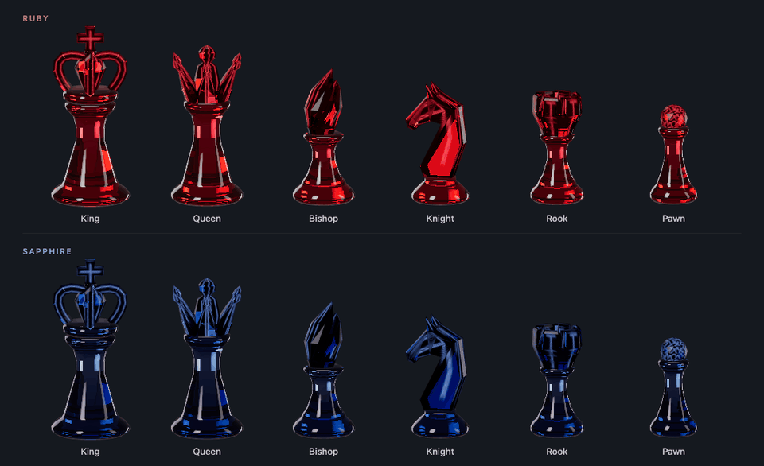
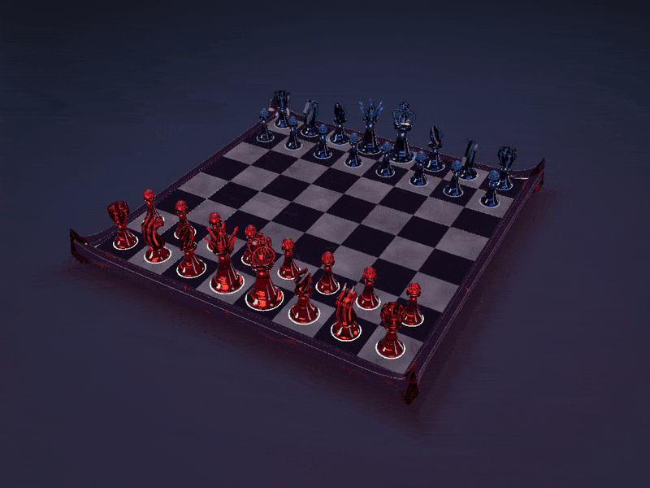
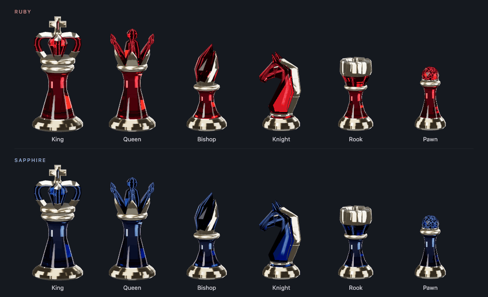
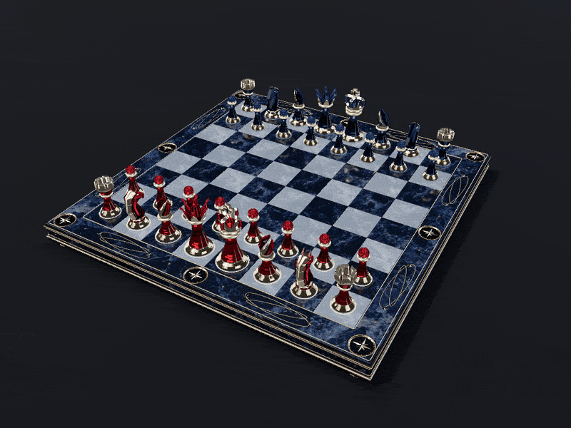

# Morph Chess

A visual playground for chessboards and chess pieces. Morph Chess explores sculpted forms, rich materials, reflections, refraction, and light—with the focus currently on board and piece design. More features will follow as the project grows.

## Ruby × Dusk Mirror

All six pieces, rotating together in both colors: King, Queen, Bishop, Knight, Rook, and Pawn.



Pure gemstone forms on smoky black crystal, with deep red light beneath the board and reflections across its surface.



## Night Oath × Midnight Silver

The same six silhouettes, accented with polished champagne-gold inlays.



Ruby and sapphire pieces with polished champagne-gold inlays, paired with midnight-blue stone and celestial metalwork.



## Run locally

Requires Node.js 20.19+ or 22.12+.

From the project directory, install dependencies:

```sh
npm install
```

Then run one of the following commands to start the local server and open a preview in your browser.

**Ruby × Dusk Mirror**

```sh
npm run dev -- --open '/?board=dusk-mirror&pieces=ruby'
```

**Night Oath × Midnight Silver**

```sh
npm run dev -- --open '/?board=midnight-silver&pieces=night-oath'
```

These previews run on your own computer. Keep the terminal running while using the board.

Drag to orbit, scroll to zoom, and select a piece followed by a square to rearrange the board. The current build is a design sandbox; chess rules and full gameplay are still to come.

Built with Three.js and Vite. Run `npm run build` for a production build.

<details>
<summary>Behind the visuals</summary>

The GIFs are captured from the project's actual models and shaders. Capture tools live in [`scripts/readme/`](scripts/readme/).

</details>

## License

[MIT](LICENSE) © 2026 AmethystineAlpaca. Third-party dependencies retain their respective licenses.
