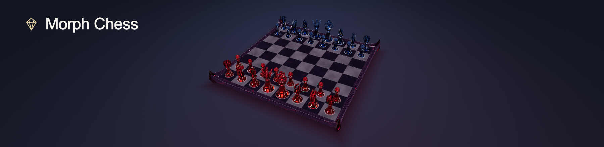
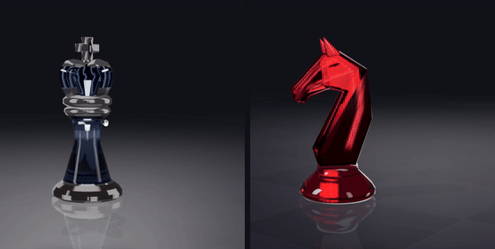

# Morph Chess

## [▶ Live Demo](https://amethystinealpaca.github.io/morph-chess/)

**Play against Stockfish AI directly in your browser.** Open the live demo on desktop or mobile — no download, installation, account, or local deployment required. The AI runs in your browser, too.

[**Ruby × Dusk Mirror**](https://amethystinealpaca.github.io/morph-chess/?board=dusk-mirror&pieces=ruby) · [**Night Oath × Midnight Silver**](https://amethystinealpaca.github.io/morph-chess/?board=midnight-silver&pieces=night-oath) · [**Interactive piece gallery**](https://amethystinealpaca.github.io/morph-chess/pieces/ruby/)

## Play against Stockfish AI

1. **Choose your side:** **First · Ruby** plays White and moves first; **Second · Sapphire** plays Black and lets Stockfish open. The board automatically turns to face your side.
2. **Choose a difficulty:** **Casual**, **Club**, or **Strong**, then press **Start game**.
3. **Make your move:** select one of your pieces, then a highlighted legal destination. Use **Restart game** to begin again with your selected side and difficulty.

- **Full chess rules:** legal moves, turn order, check, castling, en passant, and promotion to queen, rook, bishop, or knight.
- **Game results:** checkmate, stalemate, threefold repetition, insufficient material, and the fifty-move draw.
- **3D gemstone play:** captured pieces shatter, with 3D/top views and a mobile-friendly layout. Sound starts after your first interaction and can be muted.
- **Clearly credited AI:** the game displays **Powered by Stockfish AI**. If the engine fails to load, **Retry AI** resumes the current game.



[](https://amethystinealpaca.github.io/morph-chess/)
[](#play-against-stockfish-ai)
[](#full-recording)
[](#run-locally)
[](https://threejs.org/)
[](LICENSE)

**We design our own chess pieces for Morph Chess**, from their silhouettes and proportions to gemstone materials and metal inlays. [Explore the concept art and design sheets →](docs/design/README.md)

Captures bring the board to life with piece-shattering effects.



## Ruby × Dusk Mirror

All six pieces, rotating together in both colors: King, Queen, Bishop, Knight, Rook, and Pawn.


Pure gemstone forms on smoky black crystal, with deep red light beneath the board and reflections across its surface.


## Night Oath × Midnight Silver

The same six silhouettes, accented with polished champagne-gold inlays.


Ruby and sapphire pieces with polished champagne-gold inlays, paired with midnight-blue stone and celestial metalwork.


## Full recording

[Watch the full piece-shattering demo with sound](docs/media/piece-shattering-demo.mp4).

## Deployment

GitHub Pages serves the production build at `/morph-chess/`. Every push to `main` runs the tests, builds with `npm ci` + `npm run build`, and deploys only `dist/` using standard GitHub-hosted Ubuntu runners. The workflow can also be run manually from Actions. No server, custom domain, paid plan, or running local computer is needed.

For a new fork, enable **Settings → Pages → Source: GitHub Actions** and update the production `base` in `vite.config.js`, the matching path in `scripts/check-dist.mjs`, and demo links for your repository name. To check the production subpath locally, run `npm run build` then `npm run preview` and open `http://127.0.0.1:4173/morph-chess/`.

This is a noncommercial showcase. Published builds retain the [glass sound credits](https://amethystinealpaca.github.io/morph-chess/pieces/ruby/audio/README.md), [movement sound credits](https://amethystinealpaca.github.io/morph-chess/play/audio/CREDITS.txt), project license, and third-party license notices.

## Run locally

Requires Node.js 20.19+ or 22.12+.

From the project directory, install dependencies:

```sh
npm install
```

Then run one of the following commands to start the local server and open a preview in your browser.

**Ruby × Dusk Mirror**

```sh
npm run dev -- --open '/?board=dusk-mirror&pieces=ruby'
```

**Night Oath × Midnight Silver**

```sh
npm run dev -- --open '/?board=midnight-silver&pieces=night-oath'
```

These previews run on your own computer. Keep the terminal running while using the board.

**Interactive piece gallery**

```sh
npm run dev -- --open '/pieces/ruby/'
```

Choose Ruby or Night Oath, ruby or sapphire, and any of the six pieces in the
collection panel. Drag to rotate and scroll to zoom. Click the piece to shatter
it with synchronized glass sounds; click the debris to restore it. On a narrow
screen, open **Choose a piece** to switch pieces. With the scene focused, Enter or
Space shatters/restores and Escape restores. Both original piece-viewer links
and the original shatter-demo link open this gallery.

Drag to orbit and scroll to zoom. Select one of your pieces, then a highlighted legal destination. Captured pieces shatter while the capturing piece takes its square. The game enforces turns, check, castling, en passant and promotion (choose queen, rook, bishop or knight), and reports checkmate, stalemate, repetition, insufficient material and the fifty-move draw. AI calculation runs in a Web Worker so it does not block board input. If the engine fails to load, **Retry AI** resumes the current game.

Use the top toolbar for 3D/top views and sound. **Customize** lets you choose a board and piece set; applying a style opens a fresh game setup. Phones start in top view. You can also Tab to the board, navigate squares with arrow keys, select or move with Enter/Space, and deselect with Esc. Keyboard directions follow the chosen side.

### Chess engine

Rules: [chess.js](https://github.com/jhlywa/chess.js) (BSD-2-Clause). AI: the unmodified **Stockfish.js 19.0.1 lite single-threaded WASM** build, distributed under GPL-3.0. The engine and WASM are served together under `engine/`; no CDN, cross-origin isolation headers, or remote AI service is required. Engine files are pinned to an exact npm version and copied by Vite for production. Casual, Club and Strong adjust Stockfish skill and thinking time; these labels do not promise an Elo rating.

[Corresponding engine source and build scripts, v19.0.1](https://github.com/nmrugg/stockfish.js/tree/v19.0.1) · [Download source](https://github.com/nmrugg/stockfish.js/archive/refs/tags/v19.0.1.tar.gz) · [Published GPL license](https://amethystinealpaca.github.io/morph-chess/licenses/stockfish.txt). The source repository's build instructions include `node build.js --single-threaded --lite -f`. The UI's Customize panel also links the engine source and license.

Built with Three.js and Vite. Run `npm run build` for a production build.

<details>
<summary>Behind the visuals</summary>

The cover and GIFs are captured from the project's actual models and shaders. Capture tools live in [`scripts/readme/`](scripts/readme/).

</details>

## License

[MIT](LICENSE) © 2026 AmethystineAlpaca. Third-party dependencies and audio assets retain their respective licenses. The [glass sound credits](pieces/ruby/audio/README.md) include a CC BY-NC 4.0 recording restricted to noncommercial use; the [movement sound](play/audio/CREDITS.txt) is CC0.
