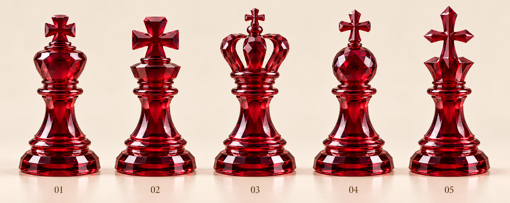
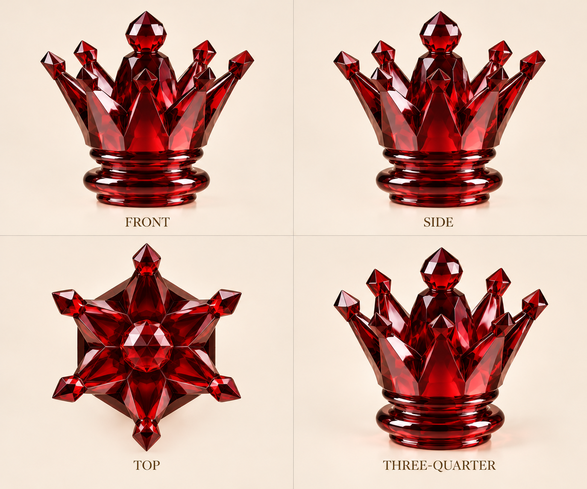
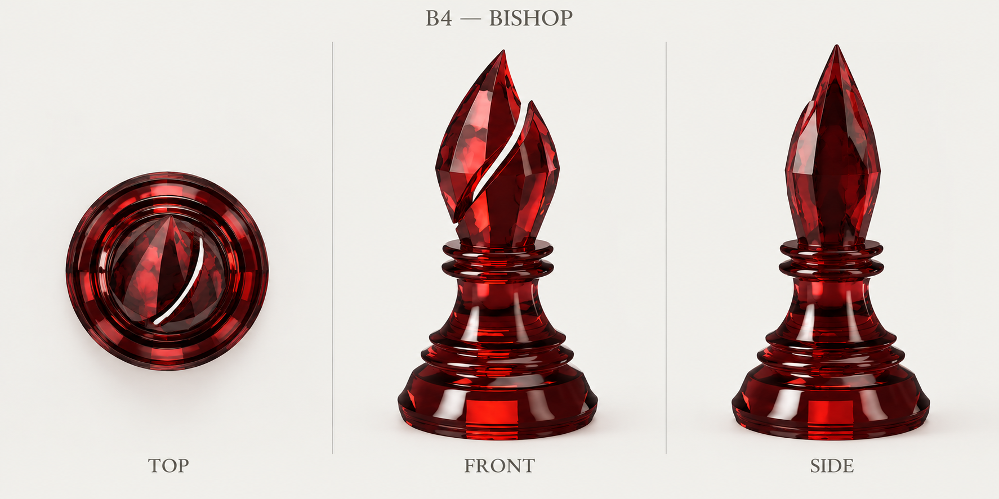
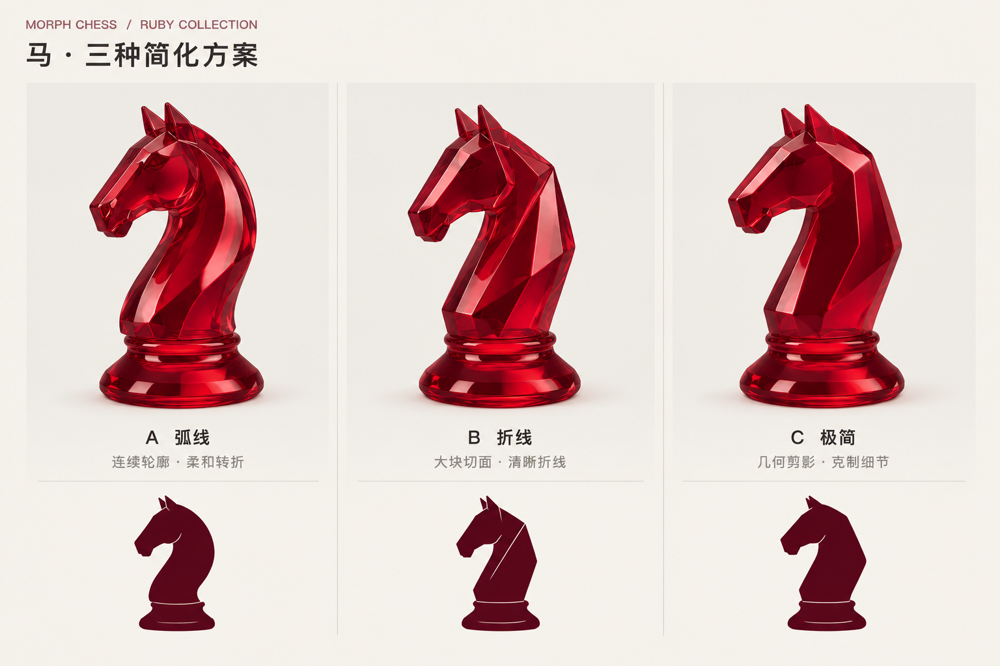
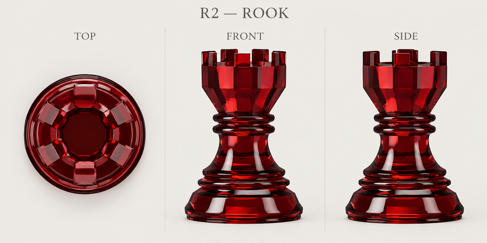
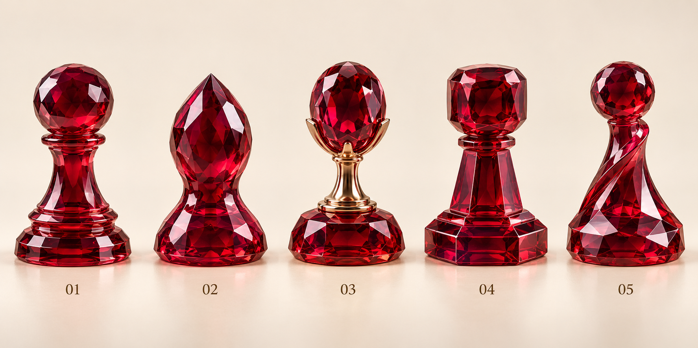
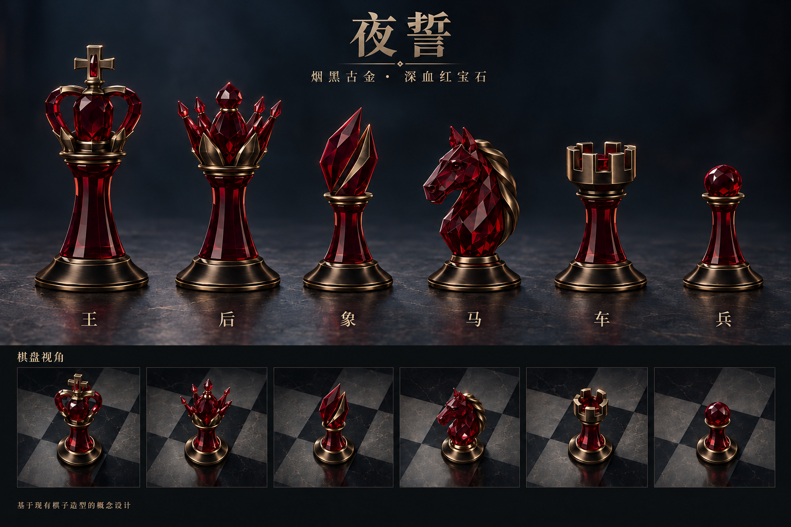
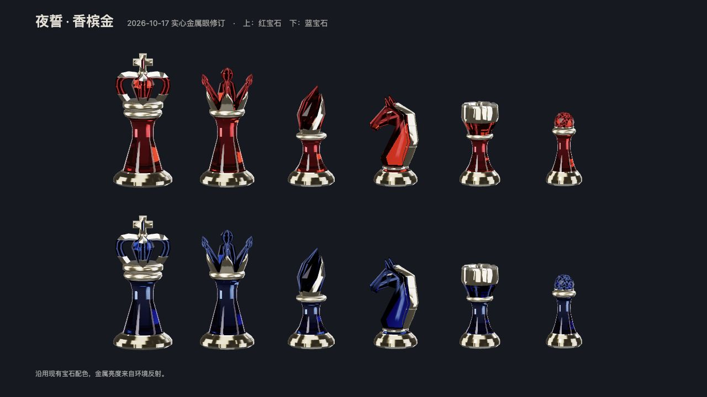

# Piece design studies

[← Back to Morph Chess](../../README.md)

Our Ruby and Night Oath collections were developed specifically for Morph Chess. These AI-assisted concept studies guided the custom 3D models; proportions, materials, and details were refined during modeling.

[King](#king) · [Queen](#queen) · [Bishop](#bishop) · [Knight](#knight) · [Rook](#rook) · [Pawn](#pawn) · [Night Oath](#night-oath)

## King

Five crown studies. Concept **03**, with its open arches, central jewel, and cross, became the basis of our king.

## Queen

The crown reference explores flared gemstone points and a central jewel from four angles.

## Bishop

The **B4** reference pairs a diagonal opening with broad, angular gemstone faces.

## Knight

Three approaches to the horse silhouette. We developed **B**, the angular design with broad planes, into the current knight.

## Rook

The **R2** reference establishes the flared tower, recessed crown, and six battlements.

## Pawn

Early studies explored different gemstone heads, stems, and bases before the collection's proportions were refined.

## Night Oath

The early metalwork concept adds gold settings to the Ruby shapes. This direction evolved into the polished champagne-gold finish of Night Oath.

The model sheet below shows the later champagne-gold finish in ruby and sapphire, including the knight's solid metal eyes.

[See the pieces in motion →](../../README.md)
